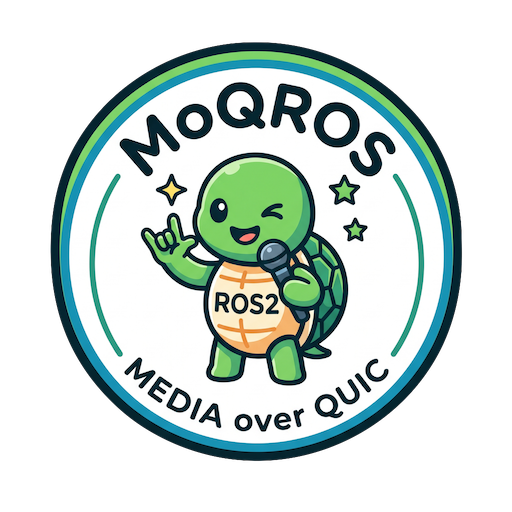
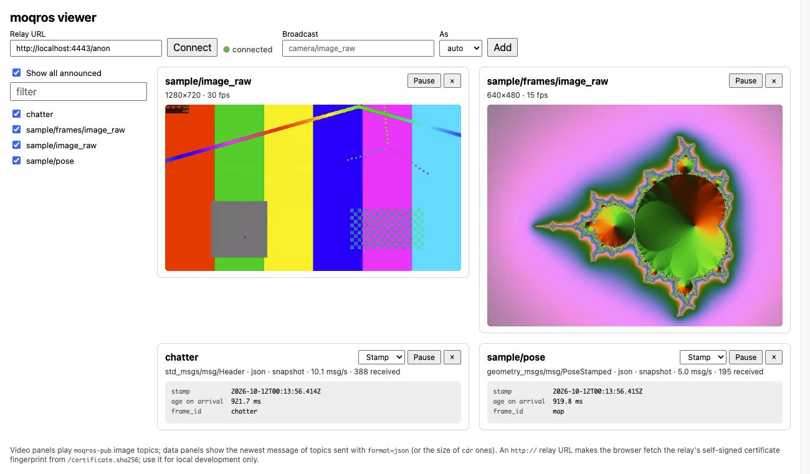

# MoQROS

[](https://crates.io/crates/moqros)
[](https://docs.rs/moqros)
[](https://crates.io/crates/moqros-cli)



Stream ROS 2 topics over [Media over QUIC](https://moq.dev) (MoQ), in Rust: images as video, and any other
message type as JSON or CDR data.

moqros converts each image to I420, encodes it (VP8, AV1, or H.264, on a GPU when one is available), and
publishes it to a MoQ relay as a
[hang](https://docs.rs/hang) broadcast. That's the WebCodecs-friendly format played by the official
[`@moq/watch`](https://www.npmjs.com/package/@moq/watch) web component. Topics of any other type go into a
hang data track instead (see [Other message types](crates/moqros-cli/README.md#other-message-types)). It can also go the other way:
subscribe to a broadcast, decode it, and republish it as a ROS topic.

```
 ROS 2 topic ──► moqros-pub ──► moq-relay ──► browser (examples/web: videos + data)
 Image / any msg       hang         QUIC/WebTransport    └──► moqros-sub ──► ROS 2 topic
```

## Layout

| Path | What |
| --- | --- |
| [`crates/moqros`](https://docs.rs/moqros) | The library ([crates.io](https://crates.io/crates/moqros)). The core (conversion, codec, MoQ publish/subscribe) is ROS-independent; the `ros` feature adds r2r bridges. |
| [`crates/moqros-cli`](crates/moqros-cli/README.md) | Bridge nodes ([crates.io](https://crates.io/crates/moqros-cli)): `moqros-pub` (ROS → MoQ), `moqros-sub` (MoQ → ROS), and `moqros-bridge` (both in one node). Also a colcon (`ament_cargo`) package. |
| [`examples/image_source`](examples/image_source/README.md) | Sample node that plays a video file (via ffmpeg) or a PNG/JPEG directory as an Image topic. |
| [`examples/sim`](examples/sim/README.md) | `teleop_sim`, a tiny simulated robot (rclpy, numpy) for the teleop demo. |
| [`examples/web`](examples/web/README.md) | Browser viewer (React, TypeScript, `@moq/watch`) for several video and data broadcasts. A hosted copy is at <https://yuma-m.github.io/moqros/>. |
| [`docker/`](docker/README.md) | Dockerfile (ROS 2 Jazzy + Rust, moq-relay), the end-to-end sample, and the teleop demo. |

## Try it (Docker)

You only need Docker:

```sh
docker compose -f docker/compose.yml up --build
```

Then open <http://localhost:8080> in a Chromium-based browser or Firefox. It shows two sample videos and two data
topics streamed from ROS through a local relay.



`docker/teleop.compose.yml` goes the other way too: drive a simulated robot from the browser while watching its
camera. See [docker/README.md](docker/README.md) for both demos.

## Bridge nodes

```sh
source /opt/ros/jazzy/setup.bash
IDL_PACKAGE_FILTER="std_msgs;sensor_msgs;geometry_msgs;nav_msgs;rosgraph_msgs" cargo install moqros-cli

moqros-pub --url http://localhost:4443/anon --topic /camera/image_raw --topic /odom,format=json
moqros-sub --url http://localhost:4443/anon --broadcast camera/image_raw --topic /remote/image
```

See the [moqros-cli README](crates/moqros-cli/README.md) for installing with colcon, the codecs and hardware
encoding, ROS parameters, data topics, authentication, and Cloudflare's MoQ relays.

## Library

```toml
[dependencies]
moqros = { version = "0.6", features = ["ros"] }   # omit `ros` for the ROS-independent core
```

See [docs.rs](https://docs.rs/moqros) for the API, data broadcasts, use without ROS, the codec features
(VP8 by default, AV1 through libaom, H.264 through Cisco's OpenH264 binary, hardware encoders through GStreamer),
and the format on the wire.

## Security

The Docker demos run a relay that lets anyone who reaches it watch *and* publish, and `moqros-sub` republishes
what arrives on ROS. Before you expose a relay beyond localhost, read the
[demos' security notes](docker/README.md#security) and the bridges'
[Security](crates/moqros-cli/README.md#security) section on TLS and authentication.

## Development

The core library builds and tests natively on any OS. ROS isn't required for it, but the default `vp8`
feature needs libvpx, pkg-config, and libclang (bindgen generates the libvpx bindings):

```sh
# Debian/Ubuntu
sudo apt install libvpx-dev pkg-config libclang-dev
# or macOS (libclang comes with the Xcode CLI tools)
# brew install libvpx pkgconf

cargo test -p moqros
# H.264 tests (skipped unless OPENH264_LIBRARY is set):
# OPENH264_LIBRARY=$(./scripts/fetch_openh264.sh) cargo test -p moqros --features h264
# AV1 (needs libaom-dev) and the GStreamer backend (needs the GStreamer packages above, plus
# gstreamer1.0-plugins-good, whose software encoders stand in for hardware ones in the tests):
# cargo test -p moqros --features av1,hw
# On a machine with a GPU, also run the checks against its hardware encoders:
# MOQROS_HW_TEST=1 cargo test -p moqros --features av1,hw -- --nocapture hardware_encoders

# Integration test through a real relay:
cargo install moq-relay
MOQROS_RELAY_BIN=$(which moq-relay) cargo test -p moqros --test relay

# Code coverage (CI reports it in the `core` job's summary and `coverage` artifact):
cargo install cargo-llvm-cov
rustup component add llvm-tools-preview
cargo llvm-cov -p moqros --html  # open target/llvm-cov/html/index.html
```

The `ros` feature, `moqros-cli`, and `examples/image_source` need a sourced ROS 2 environment and libclang,
because r2r generates its bindings at build time. Use the Docker `build` stage, or on a ROS machine:

```sh
source /opt/ros/jazzy/setup.bash
IDL_PACKAGE_FILTER="std_msgs;sensor_msgs;geometry_msgs;nav_msgs;rosgraph_msgs" cargo build --workspace
```

## License

Licensed under either of [Apache License, Version 2.0](LICENSE-APACHE) or [MIT license](LICENSE-MIT) at your option.

Dependencies have their own licenses. libvpx is BSD-3-Clause, and the `env-libvpx-sys` bindings are MPL-2.0.
libaom is BSD-2-Clause with the [Alliance for Open Media patent license](https://aomedia.org/license/patent-license/).
GStreamer is LGPL-2.1 and is linked dynamically.
Cisco's OpenH264 binary is covered by [Cisco's binary license](https://www.openh264.org/BINARY_LICENSE.txt).
