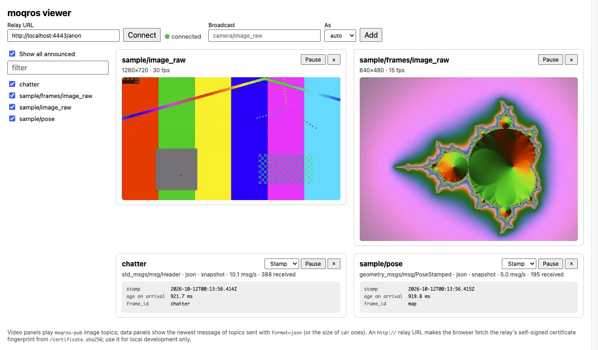

# Docker demos

Two end-to-end demos that only need Docker. They use the same ports, so run one at a time.

| File | What |
| --- | --- |
| `Dockerfile` | Stages for ROS 2 Jazzy + Rust (the bridges and the examples), moq-relay, and the web viewer. |
| `compose.yml` | The [end-to-end sample](#end-to-end-sample). |
| `teleop.compose.yml` | The [teleop demo](#teleop-demo). |
| `relay.toml` | moq-relay config: self-signed certificate, anonymous publish and subscribe under `anon/`. |
| `e2e/` | The [end-to-end checks](#end-to-end-checks) CI runs against both demos. |

Read [Security](#security) before you run either on a machine others can reach.

## End-to-end sample

From the repository root:

```sh
docker compose -f docker/compose.yml up --build
```

On first start, the one-shot `samples` service generates a test video (`samples/sample.mp4`) and a PNG
sequence (`samples/frames/`) with ffmpeg inside the container. Files that already exist are kept. To stream
your own footage, put a video file or a directory of PNG/JPEG frames in `samples/` and pass `SAMPLE=<name>`
(`SAMPLE=frames` plays the PNG sequence instead of the video). `CODEC=av1` streams AV1 instead of VP8.

Open <http://localhost:8080> in a Chromium-based browser or Firefox. Both support WebTransport. The page
connects to `http://localhost:4443/anon` and shows a panel for every broadcast the relay announces: the two
videos `sample/image_raw` and `sample/frames/image_raw`, and the latest messages of the data broadcasts
`chatter` and `sample/pose`. The [hosted viewer](../examples/web/README.md) connects there too, so it works with
the sample without the `web` service.



`compose.yml` describes each service. Besides the viewer, `moqros-sub` republishes the four broadcasts on
`/moqros/image`, `/moqros/frames`, `/moqros/chatter`, and `/moqros/pose`.

The ROS services share one network and IPC namespace, as processes on one robot would. This lets Fast DDS
use shared memory for the 2.7 MB frames. The source publishes with reliable QoS, and `moqros-pub` runs with
`--reliable`. With best-effort QoS, large images are split into many UDP fragments, and losing any one of them
drops the whole frame. In testing that cut 30 fps down to 10–20 fps. On a real robot, match the camera
driver's QoS.

To check the round trip on the ROS side:

```sh
docker compose -f docker/compose.yml exec moqros-sub bash -c \
  'source /opt/ros/jazzy/setup.bash && ROS_DOMAIN_ID=42 ros2 topic hz /moqros/image'
```

If UDP port forwarding doesn't work in your Docker setup, run the relay on the host instead
(`cargo install moq-relay && moq-relay docker/relay.toml`).

## Teleop demo

The other direction too: drive a simulated robot from the browser while watching its camera.

```sh
docker compose -f docker/teleop.compose.yml up --build
```

Open <http://localhost:8080/?teleop=robot/cmd_vel>. The `teleop` parameter adds a pad to the viewer that
publishes `geometry_msgs/msg/Twist` commands as a JSON data broadcast. Hold WASD, the arrow keys, or the pad's
buttons to drive, and press Space to stop. Only the page in use (visible and focused) publishes, so with several
tabs or windows open, the one you're using drives.

| Service | What |
| --- | --- |
| `sim` | [`teleop_sim`](../examples/sim/README.md): a differential-drive robot in a small grid world. It reads `/cmd_vel`, and publishes a first-person camera (`/camera/image_raw`), a top-down map (`/map/image_raw`), and `/odom`. It stops when no command arrives for 0.5 s, e.g. when the browser tab closes. |
| `bridge` | One `moqros-bridge` node for both directions: the two images as the video broadcasts `robot/camera` and `robot/map`, `/odom` as the JSON broadcast `robot/odom`, and the browser's `robot/cmd_vel` republished on `/cmd_vel`. |
| `relay`, `web` | The same as in the sample above. |

To watch the commands arrive on the ROS side:

```sh
docker compose -f docker/teleop.compose.yml exec bridge bash -c \
  'source /opt/ros/jazzy/setup.bash && ROS_DOMAIN_ID=42 ros2 topic echo /cmd_vel'
```

## End-to-end checks

CI (`.github/workflows/e2e.yml`) runs both demos with the compose files in `e2e/` layered on top, and a
`check` service (`e2e/check.py`, rclpy) that joins the ROS services' namespaces and validates what comes back:

- **Sample:** `/moqros/image` and `/moqros/frames` arrive as rgb8 images of the source's size with its
  `frame_id`, and `/moqros/chatter` and `/moqros/pose` with the published contents. Runs with VP8 and AV1.
- **Teleop:** a `moqros-sub` stands in for the viewer and a `moqros-pub` for the teleop pad. The camera and
  map come back through the relay, and a turn command sent as `robot/cmd_vel` turns the robot on
  `robot/odom`.

To run one locally (the demo's ports must be free):

```sh
scripts/e2e.sh sample --build
CODEC=av1 scripts/e2e.sh sample
scripts/e2e.sh teleop
```

It exits non-zero if a check fails or a topic stays silent for 120 s, and then writes the services' logs to
`e2e-logs/`.

## Security

The demos are meant for one machine:

- **Anyone who reaches the relay can watch, and publish.** `relay.toml` grants anonymous publish *and*
  subscribe under `anon/` (`[auth] public = "anon/**"`). With port 4443 reachable, anyone who knows the
  address can watch every broadcast, and can publish broadcasts of their own, which `moqros-sub` and
  `moqros-bridge` republish on ROS. In the teleop demo, that means they can drive the robot.
- **The compose files listen on all interfaces.** Their `ports:` entries bind 4443 (relay) and 8080 (viewer)
  on every host interface, and on Linux Docker's port publishing bypasses firewalls such as ufw. To keep a
  demo local, bind to loopback (`"127.0.0.1:4443:4443/udp"`, `"127.0.0.1:4443:4443/tcp"`,
  `"127.0.0.1:8080:80"`).

For TLS and authentication on a real deployment, see the bridges'
[Security](../crates/moqros-cli/README.md#security) section.
